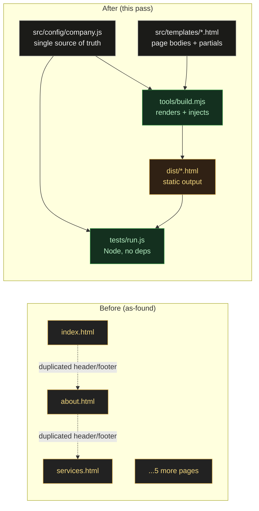
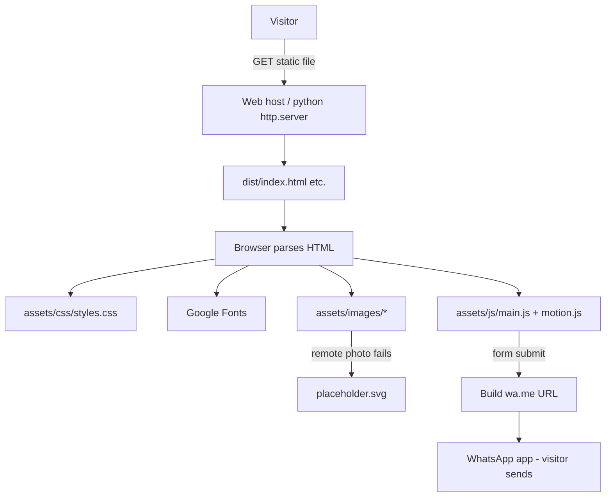
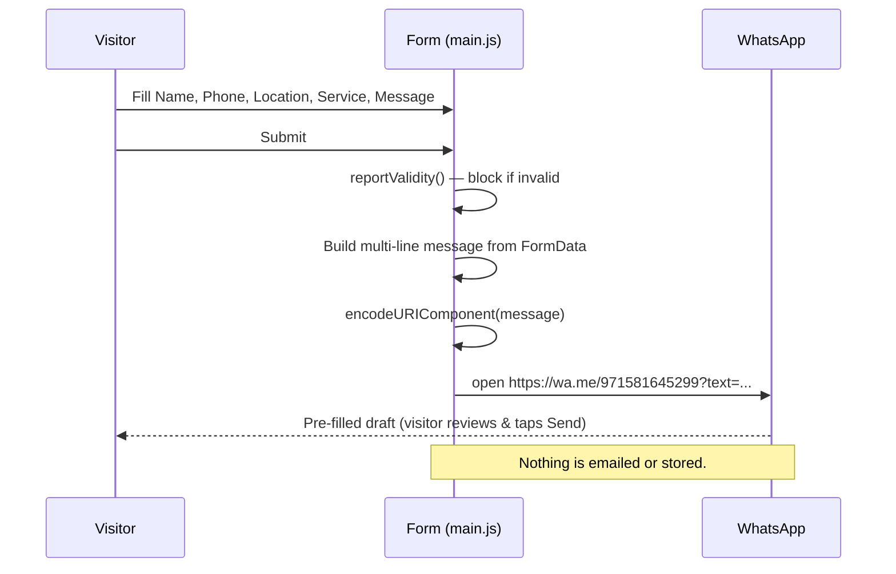

# Architecture — GRAND VIEW Website

**Version:** 1.0 · **Date:** 2026-10-11 · **Status:** LOCAL DEVELOPMENT ONLY — NOT PUBLISHED

---

## 1. Overview

A **static, dependency-free, multi-page** website. Content is authored as HTML and rendered from a
**single company-config source of truth** by a tiny Node build step that also runs the test suite.
The browser receives plain HTML/CSS/JS with **zero runtime dependencies**.

### Guiding principles
1. **No runtime dependencies.** The browser loads only our HTML/CSS/JS (+ Google Fonts).
2. **Single source of truth** for company data → prevents contact-detail drift.
3. **Progressive enhancement.** Content works without JS; JS adds menu, form, and fallbacks.
4. **Local-first, no deploy.** Nothing here publishes anything.

## 2. Current vs proposed architecture

> Note: the **published site stays static**. `dist/` is the generated, deployable output; the
> existing root `*.html` remain as the source templates' rendered equivalents so nothing breaks if
> the build is not run.

## 3. Technology choices & rejected alternatives

See `docs/architecture/` ADRs. Summary:

| Decision | Choice | Rejected alternative | Why |
|----------|--------|----------------------|-----|
| ADR-001 Framework | **Static HTML/CSS/JS** | React/Next/Tailwind/Vite | Brochure site; build adds cost/risk; conflicts with "simplest local run" + "avoid dependencies". See ADR-001. |
| ADR-002 Company data | **JS config + build injector** | Hard-coded per page | Eliminates drift; enforced by tests. |
| ADR-003 Styling | **CSS custom properties (tokens)** | Tailwind/CSS-in-JS | Already tokenized; zero build; matches existing CSS. |
| ADR-004 Motion | **CSS + tiny vanilla JS module** | Motion/Framer Motion/GSAP | No framework to host a React lib; CSS is enough for subtle reveals; honours reduced-motion. |
| ADR-005 Testing | **Node built-ins, no deps** | Jest/Playwright/Vitest | No install; runs anywhere Node exists; proves links/consistency/encoding. |
| ADR-006 Icons | **Inline SVG for key icons** | Lucide npm / icon font | Zero deps; only a few icons needed; full control. |

## 4. Rendering strategy & routing

- **Static multi-page** (MPA), not SPA. Each page is a real HTML file → best for SEO and simplicity.
- "Routing" = file names (`index.html`, `about.html`, …). No client router.
- Build step (`tools/build.mjs`) reads `src/templates/` + `src/config/company.js` and writes `dist/`.
  Running the build is **optional** for local preview (root `*.html` already work); it is required to
  regenerate after config/template changes and is what the tests validate.

## 5. Module boundaries (static-adapted)

The React-style structure from the brief is adapted to a static stack (per the brief's "adapt only
when justified"):

| Concern | Location | Responsibility |
|---------|----------|----------------|
| Company data | `src/config/company.js` | Name, phone, email, WhatsApp, location, tagline, nav, services. **Authoritative.** |
| Page bodies | `src/templates/pages/*.html` | Per-page `<main>` content. |
| Layout partials | `src/templates/partials/*.html` | `head`, `topbar`, `header`, `footer`, `whatsapp-float`, `scripts`. |
| Build/inject | `tools/build.mjs` | Renders `dist/` from templates + config. |
| Global styles | `assets/css/styles.css` (+ `src/styles/tokens.css` reference doc) | Design tokens + components. |
| Behaviour | `assets/js/main.js` (+ `src/js/motion.js`) | Menu, form, fallback, reveal. |
| Images | `assets/images/` | Logo, placeholder. |
| Tests | `tests/run.js` | Dependency-free assertions. |
| Docs | `docs/` | All engineering documentation. |

No empty abstraction layers are created; each folder has a real, single responsibility.

## 6. Data & asset flow

- **Company data** flows one way: `company.js` → build → HTML. Never hand-edited in output.
- **Assets** are local (logo, placeholder) or remote-with-fallback (Unsplash photos, fonts).

## 7. Contact-form & WhatsApp flow

## 8. Animation architecture

- A **motion token system** (duration/easing/distance) lives in CSS custom properties
  (`docs/design/MOTION_SYSTEM.md`).
- A tiny vanilla `src/js/motion.js` adds `is-visible` on scroll via `IntersectionObserver`, purely
  additive; content is visible by default if JS is off.
- **Reduced-motion:** `@media (prefers-reduced-motion: reduce)` disables transitions/animations, and
  the JS reveal checks the same media query and does nothing when reduced.
- No parallax, cursor-following, perpetual, or 3D motion (per design rules).

## 9. Error handling

- **Images:** `onerror` → branded placeholder (no broken-image icons).
- **Form:** native validation + friendly `aria-live` status; no silent failures.
- **JS:** all behaviour is feature-detected and wrapped so a missing element never throws.
- **Build:** `tools/build.mjs` fails loudly on a missing template/config key.

## 10. SEO architecture

- Per-page `<title>` + `<meta name="description">`; one `<h1>`; semantic landmarks; `alt` text.
- Open Graph (`og:title/description/type/locale/site_name`).
- Factual `LocalBusiness` JSON-LD on Home + Contact (no fake reviews/ratings).
- Canonical tags + real sitemap/robots URLs **deferred** until the domain is known (documented).

## 11. Performance strategy

- No runtime JS libs; small hand-written CSS/JS.
- `loading="lazy"` on below-the-fold images.
- Fonts: currently `@import` (documented as a future `<link>`+preconnect optimization).
- Motion uses transform/opacity (compositor-friendly) only.

## 12. Accessibility strategy

- Keyboard operable nav (Escape/outside-click close), visible `:focus-visible`, skip link.
- Labelled form controls; `aria-live` status; `aria-expanded`/`aria-controls` on the menu.
- Sufficient contrast (gold on near-black; dark text on light sections).
- `prefers-reduced-motion` respected everywhere.

## 13. Testing strategy

- `tests/run.js` (Node, **no dependencies**) asserts: routes exist, no broken internal links,
  contact consistency across pages, form fields present, WhatsApp encoding correct, assets exist,
  JSON-LD valid, SEO/a11y essentials present.
- Automated vs manual checks are separated in `docs/tasks/QA_CHECKLIST.md`.
- A test is only marked passed when it actually ran.

## 14. Dependency-management strategy

- **Runtime: zero.** Node is a dev-only tool (tests/build), never shipped to the browser.
- Any future dependency requires an ADR + licence check + a justification that CSS/JS cannot do it.

## 15. Migration & rollback strategy

- The original root `*.html` and assets are **preserved**. The build writes to `dist/` and does not
  delete source. Rollback = stop using `dist/` and serve the root `*.html` as before.
- See ADR-001 for why no framework migration is performed.

## 16. Known limitations

- Static content only; no CMS (owner edits HTML/config or re-runs the build).
- Remote photos need internet (fallback provided).
- Canonical/sitemap domain pending owner decision.
- No automated browser/visual test in this environment (manual checks listed).

